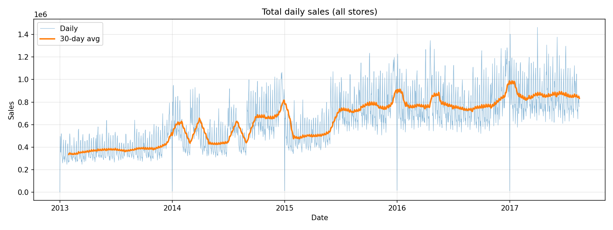
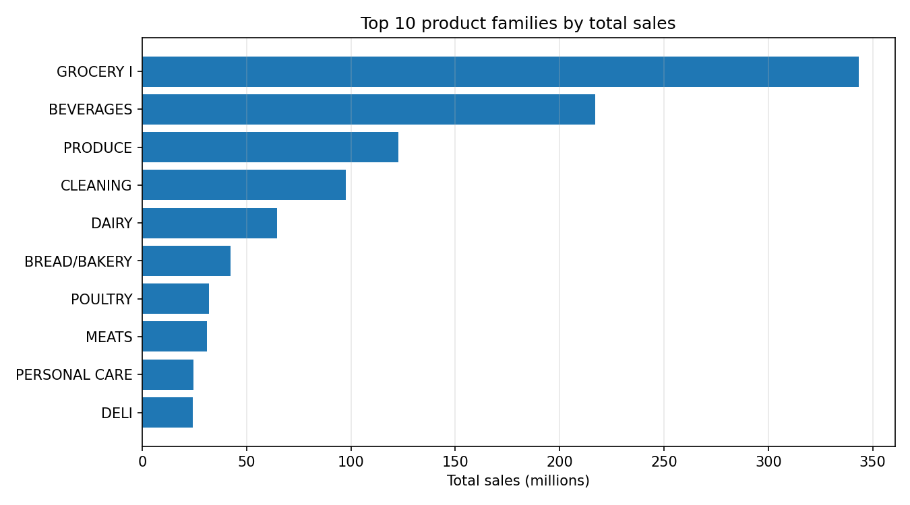
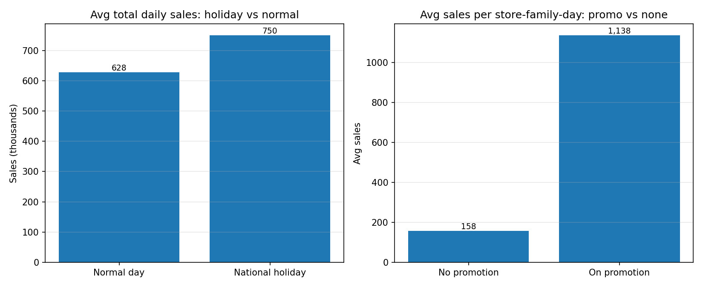

# Demand Forecast

**Problem:** Forecast monthly sales per product 3 months ahead to cut stock-outs and over-stock.

## Data source
- **Main:** Kaggle "Store Sales - Time Series Forecasting" (public, so anyone can rerun the project)
  - Daily sales by store and product family, 2013-2017, plus promotions, oil prices, holidays and store info
  - Daily data will be rolled up to monthly sales per product family
- **Optional:** anonymised family-business sales data, used with permission. It stays private and is never uploaded to GitHub.

## Get the data
1. Join the competition on Kaggle and accept the rules
2. Save your Kaggle API token in `~/.kaggle/access_token`
3. Download:
   kaggle competitions download -c store-sales-time-series-forecasting -p data/raw
4. Load into SQLite:
   python src/demand_forecast/load_data.py

**train.csv:** 3,000,888 rows, 2013-01-01 to 2017-08-15 (54 stores × 33 product families)
## Setup
pip install -r requirements.txt

## Status
- [x] Repo skeleton
- [x] Problem statement and data source
- [ ] Download and explore the data
- [ ] Baseline forecast
- [ ] ML model and evaluation
- [x] Download the data (explore next)
## EDA findings

1. **Sales are growing.** Average daily sales more than doubled, from ~386K in 2013 to ~856K in 2017 (+122%; 2017 data runs to mid-August). Sales drop to near zero every 1 January, when stores are closed.
2. **A few families drive the business.** GROCERY I, BEVERAGES and PRODUCE make up 64% of all sales, so forecast accuracy on these matters most.
3. **Holidays and promotions lift sales.** National holidays average +19% above normal days, and store-family-days on promotion sell __% more than those without. Part of the promo effect comes from promotions being used more on big families, so the model needs both features rather than taking this number at face value.

